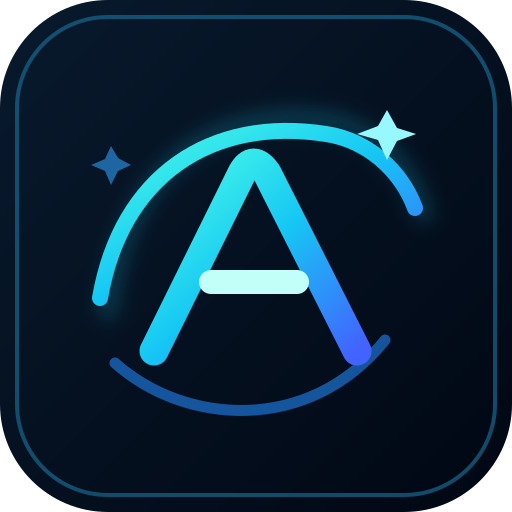

	

<h1 align="center">Winlator LSFG Aurora</h1>

<strong>Experiments in Android ARM64 Windows gaming and LSFG-VK integration.</strong>

> **Attribution:** This community branch is based on [Rafaela's Winlator LSFG fork (@amyroseee)](https://github.com/amyroseee/Winlator-LSFG), itself derived from [Winlator by brunodev85](https://github.com/brunodev85/winlator). Aurora is a distinct, unofficial experimental identity; the original projects and their authors retain full credit.

An experimental derivative of Winlator LSFG with a separate visual identity and a focus on compatibility, frame generation, and clear reporting of changes.

## Features

- **LSFG-VK integration**
  - Adapted for the Winlator glibc environment
  - Uses a user-provided `Lossless.dll`
  - `Lossless.dll` is not bundled with the app

- **Frame Generation**
  - 2x
  - 3x
  - 4x
  - The current Winlator integration is still experimental and may improve over time

- **LSFG presets**
  - Performance
  - Balanced
  - Quality
  - Custom

- **Per-container LSFG settings**
  - LSFG can be configured separately for each container

- **High Contrast FPS Counter**
  - Simple performance overlay focused on readability during gameplay

- **Save Backup & Restore**
  - Backup and restore game saves directly from the container menu
  - Supports common Wine save locations

- **Visual changes**
  - Cyan app theme
  - Updated launcher and internal visuals

## Lossless.dll

LSFG requires a compatible `Lossless.dll` provided by the user.

This project does not include or distribute `Lossless.dll`.

## Screenshots

## Project status and roadmap

The integration is experimental. Features listed above are described by this fork; performance and device compatibility may vary, and changes under development are **not** guaranteed.

- [Development roadmap](ROADMAP.md): proposed LSFG-VK, GPU, RAM, ARM64 and Discord RPC improvements
- [Contributor guide](CONTRIBUTING.md): how to report, test and submit changes
- [Testing matrix](docs/TESTING.md): how to reproduce performance and compatibility reports
- [RPC experimental 4 release candidate](docs/RPC_EXPERIMENTAL_4.md): improvements, build prerequisites and device-test checklist
- [Architecture orientation](docs/ARCHITECTURE.md)
- [Changelog](CHANGELOG.md)
- [Pull requests](../../pulls) — experimental work and community proposals (GitHub Issues are currently disabled)

**RPC experimental 4 is a development candidate, not a published APK.** It combines prior RPC work, lifecycle fixes and full Windows 32-bit assets on the Android ARM64 build; see the [v4 notes](docs/RPC_EXPERIMENTAL_4.md). A licensed Discord Social SDK AAR and real-device tests are needed before publication. No performance or compatibility gain is claimed without measurement.

## Maintainer and contributors

**Maintainer of this derivative:** [@gabrielbskk](https://github.com/gabrielbskk).

**Original Winlator LSFG fork credit:** Rafaela, [@amyroseee](https://github.com/amyroseee), [original source repository](https://github.com/amyroseee/Winlator-LSFG).

See [CONTRIBUTORS.md](CONTRIBUTORS.md) for project participation and acknowledgments. Contributions are welcome through issues and pull requests.

## Credits

- **Rafaela / [@amyroseee](https://github.com/amyroseee)** — original Winlator LSFG fork and its LSFG integration work.
- **[brunodev85](https://github.com/brunodev85)** — original Winlator.
- Current derivative maintenance: **[@gabrielbskk](https://github.com/gabrielbskk)**.

LSFG-VK and other third-party components belong to their respective authors.

## Disclaimer

This is an unofficial derivative of Winlator LSFG. It is not affiliated with or endorsed by Winlator, Rafaela's source project, Discord or Lossless Scaling. The new name and artwork do not imply original authorship of upstream code.
