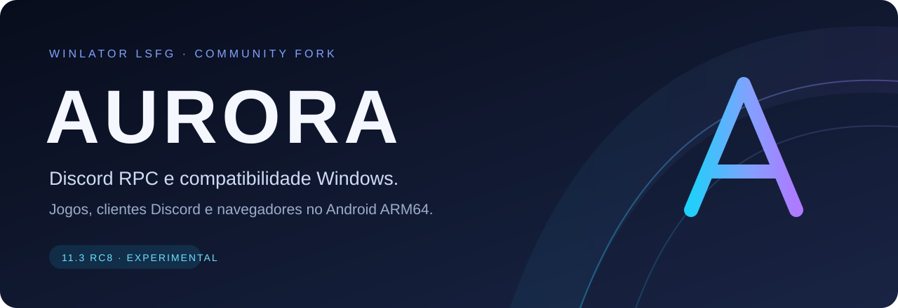

  <a href="https://github.com/gabrielbskk/Winlator-LSFG/releases/tag/aurora-11.3-rc8-discord-firefox"><strong>Baixar Aurora RC8</strong></a> ·
  <a href="docs/GETTING_STARTED.md">Começar</a> ·
  <a href="docs/DISCORD_RPC_WINLATOR.md">Discord e Firefox</a> ·
  <a href="docs/README.md">Documentação</a> ·
  <a href="ROADMAP.md">Próximos passos</a>

# Seu ambiente Windows, com o foco do Aurora

**Aurora é um fork do Winlator LSFG focado em Discord RPC opcional e compatibilidade de jogos, navegadores e ferramentas Windows no Android ARM64.** A atualização 11.3 RC8 reúne instalação de clientes Discord pelo aplicativo, download do Firefox e atalhos para usar esses programas dentro do contêiner.

A base vem do [Winlator LSFG de Rafaela (@amyroseee)](https://github.com/amyroseee/Winlator-LSFG), derivado do [Winlator de brunodev85](https://github.com/brunodev85/winlator). Aurora é um projeto comunitário independente, mantido por [@gabrielbskk](https://github.com/gabrielbskk).

## Aviso de compatibilidade da RC8 (relato do mantenedor em 18/10/2026)

**Problema conhecido:** nesta compilação experimental, o mantenedor relatou que **somente o Vesktop abriu/funcionou**, e ele já estava disponível no ambiente. Os botões de instalar Endcord, LegCord e Firefox não trouxeram um resultado funcional; o botão de reinstalar Vesktop também se mostrou desnecessário. **Não recomendamos os instaladores da RC8 até uma correção confirmada.** Não há prova de que esses outros clientes ou o navegador funcionem dentro do Wine nesta versão.

A correção está sendo tratada no [PR #30](https://github.com/gabrielbskk/Winlator-LSFG/pull/30). Preserve instalações e saves existentes; não reinstale somente para testar esses botões. Este aviso **não altera o APK já publicado** e a RC8 continua **não Stable**.

## A atualização RC8

| Você quer… | O Aurora oferece |
| --- | --- |
| Testar outro cliente Discord | Botões para instalar **Endcord GUI, LegCord e Vesktop Windows x64**, com download oficial e verificação SHA-256 |
| Abrir o Discord junto do contêiner | Início minimizado opcional do **Vesktop**, desligado por padrão |
| Usar um navegador Windows | Download verificado do instalador **Firefox ESR**, com atalho para executar a instalação no Wine |
| Acessar Discord Web | Atalho para o navegador Android e atalhos para Chrome, Edge ou Firefox já instalados no contêiner |
| Ajustar jogos e aplicativos | Configurações de Wine/Box64, preset Electron e seleção manual de drivers |
| Experimentar geração de quadros | Integração LSFG-VK com presets 2x/3x/4x e `Lossless.dll` fornecida pelo usuário |

Os clientes são downloads opcionais; seus binários não estão dentro do APK. O RPC Android antigo com Application ID não está ativo na RC8. **Endcord é uma opção para testar menor consumo de memória; ainda não há comparação de RAM comprovada no Winlator.**

## Baixe e comece

**[Abrir a release RC8 e baixar o APK →](https://github.com/gabrielbskk/Winlator-LSFG/releases/tag/aurora-11.3-rc8-discord-firefox)**

1. Faça backup dos contêineres. A RC8 é uma pré-release com assinatura debug; outra assinatura pode impedir atualização direta.
2. Instale em um dispositivo **Android 8.0+ ARM64**, com espaço para contêineres e downloads. A compatibilidade depende também da GPU, do driver e do programa.
3. Nas **Configurações do Aurora**, escolha o cliente Discord ou baixe o instalador Firefox.
4. Abra o contêiner e use os atalhos do **menu Iniciar**. Para Firefox, conclua o instalador Windows; para Discord, faça login no cliente escolhido.

Veja o [guia de primeiros passos](docs/GETTING_STARTED.md) e as [instruções de Discord e navegador](docs/DISCORD_RPC_WINLATOR.md).

## O que foi validado

A RC8 passou por testes JVM, build do APK, compilação dos testes Android e verificações de recursos no [CI do commit publicado](https://github.com/gabrielbskk/Winlator-LSFG/actions/runs/39145337062). A integridade do APK também foi conferida. A abertura do Vesktop foi observada anteriormente em um Galaxy S23.

**Continua experimental:** RPC ao vivo, Endcord, LegCord, Firefox no Wine, atualização/rollback e consumo de RAM ainda precisam de testes físicos. A compilação dos testes Android não equivale a executá-los no aparelho. Discord Web usa navegador externo; não há WebView embutido nesta release. Clientes Discord de terceiros podem trazer risco à conta.

Turnip e sua versão são escolhidos manualmente. PANVK não está integrado/validado, e LSFG não está disponível pelo caminho Vortek atual. Consulte a [compatibilidade de GPU](docs/GPU_COMPATIBILITY_AURORA.md) antes de comparar configurações.

## Explore o projeto

| Caminho | Conteúdo |
| --- | --- |
| [Central de documentação](docs/README.md) | Guias de uso, testes e desenvolvimento |
| [Versões e downloads](docs/RELEASES.md) | RC8, checksum e arquivo das versões anteriores |
| [Roadmap](ROADMAP.md) | RPC, navegadores, memória e critérios para Stable |
| [Como contribuir](CONTRIBUTING.md) | Relatos reproduzíveis e mudanças de código |
| [Critérios para Stable](docs/STABLE_RELEASE_GATE.md) | Validação necessária antes de promover uma versão |
| [Identidade Aurora](docs/BRANDING.md) | Marca, cores e atribuição |

**Código da RC8:** [tag da release](https://github.com/gabrielbskk/Winlator-LSFG/tree/aurora-11.3-rc8-discord-firefox). O código experimental segue seu fluxo de integração por PR; a apresentação na `main` descreve a release publicada, sem indicar que todos os commits da RC8 já foram integrados nela.

## Créditos e licença

Rafaela / **@amyroseee** — fork Winlator LSFG e integração LSFG. **brunodev85** — Winlator original. Autores de Wine, Box64, drivers, LSFG-VK e demais componentes — suas respectivas implementações. Veja [contribuidores](CONTRIBUTORS.md) e [licença LGPL-2.1](LICENSE), além das licenças próprias dos componentes.

`Lossless.dll` não é distribuída. Aurora não é afiliado nem endossado por Discord, Mozilla, Winlator ou Lossless Scaling. A identidade própria mantém os créditos das bases e dos autores originais.
